<div align="center">

# Bijou

Dress, pose and keep an anime doll on your desktop

[![Live][badge-site]][url-site]
[![HTML5][badge-html]][url-html]
[![CSS3][badge-css]][url-css]
[![JavaScript][badge-js]][url-js]
[![Claude Code][badge-claude]][url-claude]
[![License][badge-license]](LICENSE)

[badge-site]:    https://img.shields.io/badge/live_site-0063e5?style=for-the-badge&logo=googlechrome&logoColor=white
[badge-html]:    https://img.shields.io/badge/HTML5-E34F26?style=for-the-badge&logo=html5&logoColor=white
[badge-css]:     https://img.shields.io/badge/CSS3-1572B6?style=for-the-badge&logo=css3&logoColor=white
[badge-js]:      https://img.shields.io/badge/JavaScript-F7DF1E?style=for-the-badge&logo=javascript&logoColor=black
[badge-claude]:  https://img.shields.io/badge/Claude_Code-CC785C?style=for-the-badge&logo=anthropic&logoColor=white
[badge-license]: https://img.shields.io/badge/license-MIT-404040?style=for-the-badge

[url-site]:   https://bijou.neorgon.com/
[url-html]:   #
[url-css]:    #
[url-js]:     #
[url-claude]: https://claude.ai/code

</div>

---

## Overview

Bijou is a dress-up doll who lives on your screen. Drag clothes onto her, give her a new face and hairstyle, and keep her company: she blinks, breathes, follows your cursor, reacts when you pat her head or poke her cheek, dozes off when ignored, and asks for outfits she would like. Time spent together earns hearts, and hearts unlock more of her wardrobe. In Chrome or Edge she pops out into a small window that floats above your other apps.

**Live:** bijou.neorgon.com

---

## Features

- **Drag and drop dressing** -- 78 pieces (17 to start with) across dresses, tops, bottoms, swimwear, layers, socks, shoes, accessories and things to hold; slot rules swap a dress for a top and skirt the way you would expect
- **One body, every fit** -- each garment is generated from the body's own measurements, so it fits every height and build and follows her through every pose
- **Moves on her own** -- a bone rig with springs on her hair and skirt, 12 poses you can pick, idle routines, a twirl, and she dangles when you pick her up and lands when you let go
- **Personality** -- greetings by time of day, reactions to pats and pokes, sleepiness when ignored, a daily present, and style wishes you can grant for bonus hearts
- **Make her yours** -- seven ready-made heads, 13 hair colours, seven hairstyles, five bangs, 11 eye colours, four eye shapes, eight skin tones, height and build
- **Desktop companion** -- Pop out opens an always-on-top window (Document Picture-in-Picture); elsewhere, Companion view fits her to a small window you can park beside your work
- **Looks and snapshots** -- save up to eight full looks, and save a PNG of her in her room
- **Stays on this device** -- outfits, hearts and looks are kept in this browser; nothing is sent anywhere

---

## Running locally

ES modules require an HTTP server (not `file://`):

```bash
make serve
```

Then open http://localhost:8897.

---

## Architecture



The doll is one SVG. `rig.js` solves a bone tree every frame; every drawing (body, face, hair, garments) is a list of pieces in rest coordinates, each pinned to a bone and a depth band. The contract between them is [`docs/RIG.md`](docs/RIG.md).

```
bijou-site/
├── index.html          # Page shell: stage, wardrobe panel, dialogs
├── css/style.css       # All styles; the stage art keeps its own colours
├── docs/RIG.md         # The rig contract every drawing speaks
├── js/
│   ├── app.js          # Entry point, wires the pieces together
│   ├── rig.js          # Measurements, bones, forward kinematics, IK
│   ├── poses.js        # Pose data and the pose solver
│   ├── motion.js       # Animation loop: blending, breath, springs, drag, twirl
│   ├── doll.js         # Composes pieces into the SVG and applies frames
│   ├── body.js         # Skin pieces and hands
│   ├── face.js         # Face, eyes, expressions
│   ├── hair.js         # Hairstyles on spring bones
│   ├── paint.js        # Colour, outlines, cel shading, fabric patterns
│   ├── wear-kit.js     # Garment shape builders (bodice, sleeves, skirts, trousers)
│   ├── wear.js         # Clothes generators, the base slip, the outfit compositor
│   ├── wear-legs.js    # Socks, tights, shoes
│   ├── wear-acc.js     # Hats, hair pieces, neckwear, glasses, held items
│   ├── catalog.js      # Every item, its slot, tags and unlock
│   ├── looks.js        # Skin, hair and eye palettes, styles, ready-made heads
│   ├── behavior.js     # Her mind: idles, reactions, sleep, wishes
│   ├── lines.js        # What she says
│   ├── wardrobe.js     # Equipping, unlocking, hearts, streaks, milestones
│   ├── interact.js     # Pat, poke and pick up gestures
│   ├── dnd.js          # Dragging clothes on and off
│   ├── fx.js           # Particles and the speech bubble
│   ├── stage.js        # The four rooms
│   ├── companion.js    # Pop-out window, Companion view, snapshots
│   ├── thumbs.js       # Wardrobe thumbnails and mini dolls
│   ├── render.js       # Wardrobe, worn strip, hearts, wish
│   ├── panels.js       # Style, poses, looks, progress
│   ├── events.js       # Every listener
│   └── state.js        # Saved state, validated on load
├── robots.txt
├── sitemap.xml
├── CNAME
├── Makefile
└── README.md
```

---

<div align="center">
<sub>Part of <a href="https://neorgon.com/">Neorgon</a></sub>
</div>
